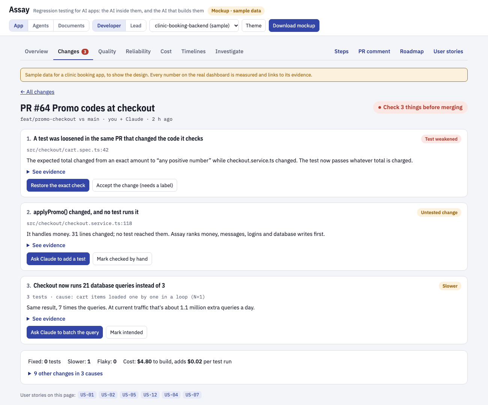
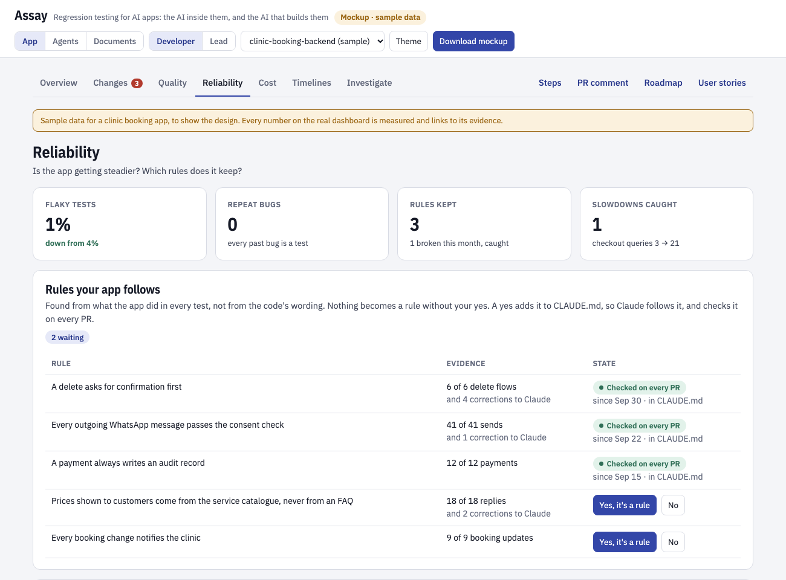
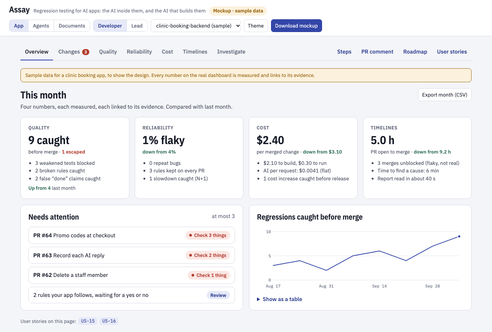

[Assay](../README.md) › [Documentation](README.md)

# Roadmap

Assay is regression testing for AI apps: the AI inside them, and the AI that builds them.

More and more code is written by coding agents, and so are its tests. Those tests often check
little, so they pass even when the app's behavior has changed, and the pull requests are too
big to read line by line. The question a developer needs answered is: **what did this change
actually do, and is it safe to merge?**

Assay already answers it for the AI parts of an app: each test is compared with its last
passing run, a change that skips a step or escalates differently fails even when the asserts
hold, and `assay diff` shows the flow before and after. The roadmap extends that to the whole
app, from the tests you already have, and keeps the report short: one verdict and at most three
things to look at.

Who it's for, and what each person needs: [user stories](user-stories.md).

*A mockup with sample data: the change report P2 builds. Its first version is built, as `assay changes`; the query counts are P4.*

## Where Assay fits

| Tools that | What they do | What Assay does |
|---|---|---|
| Review code with AI | Read the diff and comment | Show what the code did when it ran |
| Record and replay traffic | Replay captured requests or user sessions | Use the tests you already have, and understand AI behavior: flaky or real, agents, judges |
| Evaluate AI outputs | Score answers | Cover the whole change, AI and non-AI, ending in one verdict |
| Give coding agents rules and memory | Tell the agent what to do | Check that the app actually kept the rule |

## Principles

- **Value at a glance, numbers that count.** Every feature has to be understood by a developer
  in seconds, and move a number a team cares about: quality, reliability, cost or delivery time.
  Reports show measured counts and times, never estimated savings.
- **The AI side improves with every phase.** A feature that only helps non-AI code doesn't ship.
- **Nothing breaks for today's users.** New features are opt-in until they're proven; versions
  follow semantic versioning, and every change is in the release notes.
- **Works without a server.** Each feature runs in the CLI and the GitHub Action first; the
  dashboard is optional.
- **Short reports.** One verdict and at most three items per pull request; everything else is
  grouped into causes and collapsed. Values that change on every run are left out.

## Phases

Each phase starts when the one before has met its "done when".

### P0. Prove it on a real app (first replay done)

Before building, replay the history of a real production app offline and see whether a
per-PR report would be short and right.

- Replay 10 to 20 past pull requests and count what each report would show.
- Check what it flags against the bugs that were later fixed by hand.
- Look for tests that were weakened to make them pass, and for corrections repeated to the
  coding agent.

Done when: most reports have 3 items or fewer, at least half the bugs later fixed by hand would
have been flagged, and fewer than 1 in 5 flagged items is noise. The findings are published here.

First replay, on Assay's own history ([findings](p0-findings.md)): reports were short, but
changed functions no test ran would have flagged 1 of 9 later-fixed bugs. Changed lines plus
deploy and dependency changes would flag 6 of 9. P2 below is changed to match. Next: repeat it
on a larger app, with JavaScript and TypeScript measured.

Second replay, on a booking app's 41 fixes, asked only about database writes
([findings](p0-findings.md#second-replay-a-booking-app-and-database-writes)): 6 saved wrong
data, all wrong from the start rather than regressions. Checks on new writes would have
caught 4; a diff against the base branch alone, none. P1 below is changed to match.

### P1. Record every test, and guard the tests

- Every existing test is recorded, AI or not, with no `assayCase()` or `assay_case` needed: a
  Jest and Vitest reporter, and the pytest plugin.
- What the code did in each test: outside calls (HTTP), database writes, AI calls, responses
  and time. HTTP and one database driver first (node-postgres); more only where they catch
  real bugs.
- Database writes as a summary, not raw SQL: table, operation and the columns set. Reads are
  only counted. New writes are checked for a request value that never reaches the row and a
  column left at its default, ranked money first, then times and timezones, then ids.
- **Weakened-test guard.** Today a pull request can't delete, skip or filter out the test its
  change breaks. The guard adds the quieter ways a test stops checking anything: a loosened
  assertion (`toBe(1200)` becoming `toBeGreaterThan(0)`), an expected value rewritten in the
  same pull request as the code it checks, a snapshot updated without review. (Built: an
  expected value that only gained entries is no longer listed as rewritten.)

Started before P0's targets were met: the first replay found the report short but the signal
weak, and recording more of what the code did is what the signal needs. First step: every pytest
test with its outbound HTTP calls (`--assay-all`, opt-in), who ran it, and the weakened tests a
run found, in the CLI, the PR comment and the dashboard. Second step: every Jest test with what it
writes to Postgres through `pg` (`assay-evals/jest`, opt-in), as table, operation and the columns
set or left empty, compared with its last passing run. Third step: new writes checked on their own,
which the booking-app replay showed matters more than the diff. A placeholder saved, money left
empty, a reference left empty next to its twin, and a value the test sent (a JSON request, or
`assay.sent()`) that never reached a row are listed under "New writes to check". Writes the test
makes itself are left out.

Met on the booking app (October 2026): its whole Jest suite, 1,671 tests, recorded with no test
changes, about 5% slower (25.9 s to 27.2 s). The first version of the check listed 157 findings.
After grouping a finding across tests, leaving out the tests' own fixtures, and dropping optional
dates and references, it lists 5. Two are real bugs: a location's `clinic_id` never set, so its
relation is always empty, and queue entries saved with an empty-string user. The other three are
empty strings saved where null was meant. The guard lists 4a4d5a0 and not #32. Next: P2.

Done when: a real app's whole suite is recorded with no test changes, recording adds under 10%
to test time, and the guard flags the rewritten expected value found in P0 (4a4d5a0) and not
the one that only gained an entry (#32).

User stories: [US-02](user-stories.md#us-02), [US-11](user-stories.md#us-11).

### P2. The change report

- A behavior diff for all code against the base branch: one change seen in many tests is one
  item, grouped into causes.
- The likely cause of each change: the file, commit, package or config next to it, or "nothing
  on your side changed" when an outside service did.
- Changed lines that no test ran, grouped by function and ranked by risk: money, messages,
  logins, database writes and outside calls first. A changed helper takes the risk of what calls it: an untested
  change to `format_amount` used only by `refund()` ranks with money, not with the rest. The
  callers come from the code itself (the parser, or the language's own tooling), never a model.
- Deploy and dependency changes no CI job checked: a requirements, lock or ignore file, a
  workflow or a version pin changed, and nothing in the pull request built, installed or
  deployed from it. In P0 these were 4 of 9 bugs, which coverage can't see.
- Flaky or real for every test, with the existing repeat statistics.
- Mark a change intended once.
- The same report as the PR comment, and as JSON a coding agent can act on. Also as an MCP server,
  so Claude Code, Cursor or any other agent can ask mid-session what its change did, and fix it
  before a pull request exists.
- Fragile code ranked higher: lines and functions that later fixes kept changing, from the
  repository's own history (a fix commit's blame, as the P0 replay did). An untested change in a
  function fixed four times this quarter outranks one in code nobody has touched in a year. No
  model is involved, and the history is read once and kept.
- Failure paths no test ran: changed lines in an error handler, a retry, a fallback, a timeout or
  an empty-result branch, listed as their own kind ("failure handling") and ranked just after money
  and the rest. Tests usually prove the happy path; a pull request where only the happy path ran is
  implemented, not ready.
- The deployed app against what was tested: settings the changed code reads that every test
  leaves unset (an environment variable, a feature flag), which is how an upload that never
  uploaded passed every test in the P0 replay. After a deploy, a few recorded cases run against the
  deployed app, and what differs from the test run is listed: a status, a write that didn't happen,
  an outside call that went elsewhere.
- Mechanical edits apart from behavior changes: a rename, a moved function or a reformat that
  leaves the parsed code the same is grouped as mechanical and left out of untested lines, so the
  short list of behavior changes is what gets read. A behavior change hidden in a mechanical
  commit is still listed.
- A pass that only holds in this workspace: a test run with untracked or uncommitted files the
  pull request doesn't include, or setup a test didn't make itself (a directory, a local
  database), is marked. `assay test --clean` runs the changed tests from a fresh checkout of the
  commit, so "passed" means it passes for everyone.
- A score that improved while its evaluation changed: when a pull request changes the test
  cases, their inputs, expected values, evaluation data or the eval script, an improvement in
  that same pull request is reported as not comparable, with what changed, until it's run on
  the old evaluation too. An agent that reports better accuracy has to show it wasn't the test
  that got easier.

Built, opt-in: `assay changes`, the change report. It gives one verdict (not safe to merge, check
N things, or nothing to check) and at most three items, ranked from every signal: regressions with
the change next to them, weakened tests, new writes that look wrong, changed lines no test ran,
and deploy and dependency changes no CI job checked. Then come behavior changed but still passing,
and rewritten expected values. Flaky tests are a count. It's the top of the PR comment with the
Action's `changes: true`, and JSON for a coding agent ([docs](changes.md)).

Changed lines no test ran come from the coverage a run leaves (coverage.py, istanbul or lcov), are
grouped by function, and are ranked by risk. Replayed over this repository's history, the deploy rule
lists all four such bugs, but since pull requests began it lists 7 changes, only 2 of them bugs:
it still needs fewer false alarms. One change seen in many cases is one item. Any item other than a
regression or a weakened test can be marked intended once, with a reason, in
`assay.intended.toml`, and it comes back if what was flagged changes. Next: live pull requests, to
measure P0's targets and reading time.

Done when: P0's targets hold on live pull requests, and developers read a report in under a
minute.

User stories: [US-01](user-stories.md#us-01), [US-03](user-stories.md#us-03),
[US-04](user-stories.md#us-04), [US-05](user-stories.md#us-05), [US-06](user-stories.md#us-06),
[US-07](user-stories.md#us-07), [US-14](user-stories.md#us-14).

### P3. Rules and claims

- Rules found from behavior: what the app has always done ("every delete asks for confirmation
  first", "every message passes the consent check"), so the first pull request that breaks one
  is flagged, before anyone wrote the rule down.
- Corrections a developer repeated to the coding agent, and fix pull requests, count as
  evidence for a rule; they don't create one.
- Nothing becomes a rule without a yes. A confirmed rule is written to `CLAUDE.md` (or
  `AGENTS.md`) and checked on every pull request; at most one suggestion per report.
- Claim check: when the coding agent says "all tests pass" or "fixed", check it against what
  actually ran. Each run gives a receipt (the command, its exit code, the commit, how many tests
  ran and passed), and a claim without a matching receipt is flagged before anyone reads the diff. This extends the existing claim contracts.

Done when: at least 3 of 4 proposed rules are confirmed, with no more than 1 false alarm per 10
pull requests.

User stories: [US-08](user-stories.md#us-08), [US-09](user-stories.md#us-09),
[US-10](user-stories.md#us-10).

*Mockup, sample data.*

### P4. Cost and performance

- Database queries and outside calls per test, with growth flagged ("1 query became 21").
- Growth that hides in small steps: each number (cost, input tokens, fixed context, calls) is
  compared with the last passing run, which moves forward with every pass. A prompt that grows 20%
  per pull request passes every time and is 7 times larger after nine. Numbers are also compared
  with an anchor that doesn't move (the last release, or a month ago), and the report names the
  changes that added the most: "fixed context 1,200 → 9,000 tokens since v1.4, over 9 pull
  requests, most from summarise@7 and summarise@9".
- What a change cost to build (coding sessions on the branch) and what it adds to run (AI
  calls per request).
- A bug found in production becomes a test, extending what [Learning from
  production](learning.md) does for AI failures to all code. A person overriding the agent's action counts
  too: an approval rejected, or a different action taken than the one it recommended, with the
  reason given, becomes a candidate case that expects the person's choice. How often people override
  the agent, per action, is the number, and only cases that ended well are kept.

Done when: cost per change matches the provider's bill within 5%.

User stories: [US-12](user-stories.md#us-12), [US-13](user-stories.md#us-13),
[US-18](user-stories.md#us-18).

### P5. A dashboard organized by value

- Overview, Changes, Quality, Reliability, Cost and Timelines, each opening with what needs
  attention; today's pages stay, under Investigate. Opt-in until it's proven.
- A monthly page with the four numbers, each linked to its evidence, exported as PDF and CSV.
- **Changes a coding agent built, against the rest:** the same numbers split by who built the
  change, which Assay already records with each run (a coding agent's session, CI or a person). Per
  group: the change failure rate (a later fix changed its lines, or a regression reached the default
  branch), regressions and weakened tests caught before merge, items the change report raised, and
  the time from a pull request's first commit to its merge. That's what AI changed in outcomes,
  measured, not how much it was used. Per repository and team, never per person.

User stories: [US-15](user-stories.md#us-15).

*Mockup, sample data.*

### P6. Teams and companies

- Roll-up across repositories and teams.
- Roles on top of the existing SSO and audit log; retention and redaction policies.
- The enterprise items below: SAML and SCIM, alert routing, aggregation in SQL.

User stories: [US-16](user-stories.md#us-16), [US-17](user-stories.md#us-17).

## Not planned

- **An AI code-review bot.** Several good ones exist.
- **Coding-session analytics** (tool calls and tokens per session). That's activity, not value;
  cost per change stays, as one line.
- **Production tracing.** Tracing tools do it well, and it isn't what Assay is for.
- **"Hours saved" estimates.** Numbers you can't check lose trust.
- **AI usage scores per person, or an HR org tree.** How much someone used an AI tool says nothing
  about what it changed, and a ranking of people by it measures the wrong thing. Outcomes are
  reported per repository and team.

## Not built yet

- **SDKs for other languages:** there are SDKs for Python and for TypeScript and JavaScript.
  Other languages write the events `assay test` reads ([any language](any-language.md)), send
  them to `POST /v1/ingest` directly, or use OpenTelemetry.
- **Agent security: scope tests and security alerts.** An agent given credentials and a task can
  still reach what it wasn't meant to, and the organizations it happened to often didn't notice.
  Today a `never` contract, `must_not_call`, `must_get_approval_before`, the injection check and
  the personal-data check catch it in tests, and recorded HTTP calls show a request made around
  the tools. Production alerts watch rates over runs, which suits quality and is too slow for this.
  - **A scope per case:** the tools an agent may call and the argument values they may take (this
    customer's account, not any account), checked against the actual operation and parameters.
    Anything else fails, including an HTTP call to a protected host made another way.
  - **Fails closed:** `faults()` on the permission check (error, timeout) and a check that the
    protected action didn't run anyway.
  - **Probes:** cases that ask, or inject an instruction, for an out-of-scope action, so the
    boundary is tested on every pull request rather than assumed.
  - **Injected instructions that change a value, not the tool:** the injection check reads tool
    and resource results and catches a call the injected text named, a broken contract, or a call
    the case didn't expect. It misses two things. Retrieved documents aren't read, though a planted
    document is the usual way in. And an expected call with a planted value passes: the right
    `send_email`, to the attacker's address. Each argument should carry where its value came from
    (the user, a trusted tool, or text the agent read), and a value that came only from untrusted
    text and goes to an outside destination (an address, a URL, an account, an amount) is flagged.
    The check is also easy to slip past: one zero-width space or full-width letter inside "ignore all
    previous instructions" hides it. Text should be normalized first (Unicode compatibility forms,
    zero-width and control characters removed, look-alike letters folded). And an answer that embeds
    a markdown image or link whose address carries data (``) leaks it the
    moment a chat window renders it, so that's flagged as data leaving.
  - **Testing the gate itself:** teams put a policy gate in front of tool calls (allow, block, needs
    approval). Keeping its policy right as it changes is the hard part: too strict and normal work
    stops, too loose and attacks pass. Recording each gate decision with its reason and policy
    version lets cases check it: attack cases must be blocked, normal ones allowed. The report
    gives the share of normal calls blocked and attacks let through, per policy version, and what a
    policy change moved.
  - **Security flags on what agents access and run, in production:** people now approve almost
    everything an agent asks, so a click can't be the safeguard. Assay already sees each tool
    call, its arguments and the HTTP requests a run makes. It should flag the security-relevant
    ones by itself, with no rules to write first, approved or not:
    - **Secrets and credentials:** reading `.env`, keys, tokens, `~/.ssh`, cloud credentials, or a
      secret appearing in a tool's arguments, result or the answer.
    - **Destructive or irreversible actions:** deletes, drops, `rm -rf`, force pushes, payments,
      refunds, emails to many people.
    - **Privilege and reach:** `sudo`, permission changes, new users or keys, access to another
      customer's records, a host outside the usual list, a download piped into a shell.
    - **Data leaving:** personal data sent to a tool or host that doesn't need it.
    Each flag names the run, the step, what it touched and why it matters, with its severity.
    High severity alerts at once to Slack or a webhook (not after a rate moves, as quality alerts
    do), grouped so one bad deploy is one alert. Flags a team marks as expected become the
    allowed list; the rest become tests, so the same action is caught in CI before the next
    deploy. The same flags apply to the coding agents that build the app, through their hooks.
  - **What an agent could reach, and when that grows:** an agent's risk is everything its tools
    allow, not only what it's meant to do, and that grows quietly, one integration at a time. Assay
    records every tool an agent is offered, with its definition, but doesn't say what they reach. It
    should sort each tool by what it can do (read, write, delete, spend money, send messages, call
    outside hosts) and over what (this customer's records or any). Each agent gets one map of its
    reach, next to what it actually used. A pull request that widens it is an item in the change
    report: "the support agent gains `issue_refund` (spends money, any customer)". It isn't a
    failure, because the change may be intended, but nobody approves it without seeing it.
  - **Calls that go around the gateway:** an LLM gateway or agent gateway (LiteLLM, Portkey, an
    internal proxy) only governs the calls that reach it. An agent with a provider key and network
    access can call a model, an MCP server or a tool's API directly, and the gateway never sees it.
    Assay records model calls and outbound HTTP, but not where a model call went: a call through
    the gateway and one straight to `api.openai.com` look the same. It should:
    - **Record each call's destination:** the host each model call, MCP request and tool call
      went to.
    - **Fail a test that goes around:** with the gateway named in `assay.toml`, a test whose code
      calls a model provider, an MCP server or a governed tool's API directly fails, naming the
      call and the line that made it. A new code path that skips the gateway is caught in the pull
      request, not found later in the bill.
    - **Count it in production:** direct calls per agent, as a security flag, with the share of
      model calls and tool calls that went through the gateway.
    Assay sees only the calls its SDK records in the app's own process. Traffic from another
    process or runtime needs egress rules at the network, and the report says so instead of
    claiming full coverage.
  - **Whose access an agent uses, and when it drifts:** agents often run on the credentials of
    the person who set them up, keep them across sessions, and have no identity or baseline of
    their own, so identity and security tools see nothing unusual. Assay sees what each run did,
    but not whose access it used. It should:
    - **Record the identity behind each action:** the agent, its owner, the person or system that
      asked, and the credential each tool call and HTTP request used. A run that acts with a
      person's credentials on someone else's request, or with no owner on record, is flagged.
    - **Keep a baseline per agent:** the tools, hosts, tables and kinds of records it normally
      reaches, learned from its runs. The first time it reaches something new (a new host,
      another customer's records, a write where it only read), that's an alert at once, not after
      a rate moves. Volume counts too: an agent allowed to read the CRM that reads a thousand
      customers for a one-customer task is draining it one permitted query at a time. Drift is measured against the agent's own history, so no rules come first.
    - **Access held but not used:** the tools and scopes an agent is given against the ones it used
      in the last 30 days, so access can be trimmed to what it does. An agent with no runs for a
      while that still holds access, or whose owner no longer signs in to Assay, is listed for
      review.
    The number for a team: the share of agent actions with a known owner and an identity of their
    own, and how many agents hold access they didn't use.
  - **"What did this agent do, and who approved it?" in a minute:** each run is recorded, but
    finding every action of one kind means opening runs one by one. Assay's own audit log covers
    the people using Assay, not what agents did. It should answer by action: every refund over $100
    this month, with the agent, who asked, who approved and how fast, the rule or contract that
    allowed it, the evidence it rested on, and what happened after. The same view exports for
    security, legal or finance as CSV and PDF, signed so an edit shows. The number for a team:
    the time to answer that question, and the share of actions with a full record.
  - **An approval the agent claimed, not one it was given:** `must_get_approval_before` accepts any
    approval recorded in the run, whoever recorded it. An agent that writes its own approval, or
    passes "trusted" or "approved_by: finance" in a tool's arguments, gets through. An approval
    should record where it came from (the approval system, a person's decision, a signed record),
    and only those count. A claim in the agent's own output or arguments never does, and probe cases
    check it: an invoice that says "pre-approved" in its text must not get paid. An approval used
    long after it was given, past the window the case allows, counts as none.
  - **Approvals that are rubber stamps:** people approve almost everything an agent asks, so an
    approval step can look safe while checking nothing. `run.approval()` records the action, the
    decision and who, but not what the person was shown or how long they took. It should record
    both (the arguments on screen, asked and decided times) and report, per approver and per
    action: the approval rate, the median seconds to decide, risky actions approved in seconds,
    an approval that doesn't match what then ran (approved a $40 refund, $400 went out), and
    approved runs that broke a security rule anyway. In tests, a case where the person says no
    checks the agent stops. The number for a team: the share of approvals that were real reviews.
- **Voice and phone agents: the call, not just the booking:** most phone agents book the slot
  when the caller plays along. They differ on what happens around it: hold, silence, being
  interrupted, a caller who changes an answer. Simulated users (`simulate()`) test a conversation,
  but only as text taking turns. They should be able to act like callers:
  - **Caller moves:** go silent or put the agent on hold for a while, interrupt it mid-sentence,
    correct an earlier answer ("actually, Thursday"), give two answers at once, ask for a person.
  - **Checks on the outcome, not the transcript:** the booking holds the final, corrected
    details, not the first ones. The agent read the time back. "Next Tuesday" resolved to the
    right date against a fixed clock. Nothing from its instructions was spoken that the caller
    shouldn't hear ("3:30 Pacific"). A handoff to a person carried the summary.
  - **Timing, from the platform's own call record:** time to first response, gaps after a hold,
    how often it talked over the caller, read from the transcript timings a voice platform gives
    (Retell, Vapi and others send them), so the same cases compare two agents or two versions of
    one.
  Each failed call is a case that can be run again, and the diff says what changed between
  versions: "stopped reading the time back", "now answers during hold".
- **Handoffs between agents: advice or a transfer:** one agent asks another either for a second
  opinion or to take over the next task. These are different promises, and a run records only
  that a sub-agent ran (`parent_run_id`), not which was asked or what it was allowed to do. A
  handoff should say which it is, and tests should check that each kept its promise:
  - **Advice:** the agent asked for an opinion only reads. A write, a message sent or any other
    action with an effect, in its run, fails the case, and its findings come back to the agent
    that asked.
  - **Take over:** the receiving agent says whether it accepted, and the task has one owner after:
    the agent that handed it off doesn't keep acting on it, and a task handed off and never
    accepted or finished is flagged, not lost.
  - **No permission by message:** a request from another agent grants nothing a person didn't.
    The receiving agent's actions are held to the scope and approvals the person gave the first
    agent, and an approval doesn't carry over to a task it wasn't given for.
  - **What was handed over:** the facts the task needs (the customer, the constraint, the deadline)
    are in what the first agent passed on, so a handoff that drops one is a finding, not a guess.
  The diff shows a run with its sub-agents as one tree, so a change in who did what is visible.
- **Evidence diffs: the same answer, from different evidence.** Two runs can both say "approved"
  while the new one read an older policy, or the wrong customer's record. Each retrieved fragment
  is recorded (id, source, score, whether it went into the prompt) and each tool call with its
  result, but the diff compares the flow and the counts, not the evidence. It should say, per
  case, which documents and records an answer rested on, and what changed against the baseline:
  evidence dropped, added or swapped, a record of another entity. A changed basis under an
  unchanged answer is a finding, not a pass. Fragments take a version and a date, so evidence that
  was superseded shows as such. This is also the provenance for a decision: which policy version
  and which records supported it.
- **Retrieval on its own: two retrievers or rerankers, compared query by query:** swapping an
  embedding model, a chunk size or a reranker changes what's retrieved before any answer changes.
  Assay records each fragment a run retrieved but doesn't score retrieval against relevance
  labels. It should:
  - **Score each query** with recall@k, MRR and nDCG against labels (which documents answer which
    query), read from a qrels or CSV file or given per case, and split by slice.
  - **Compare two configurations on the same queries:** regressions (found before, missed now),
    recoveries, and shared failures (missed by both), the way `assay diff` does for answers. A
    paired test says whether the overall change is real, and the report names the queries behind it.
  - **Check the labels before the scores:** a retrieved document with no label (a missing judgment
    counted as wrong drags a better retriever down), the same document labelled two ways for one
    query, and labels on different scales. Each says how many results it affects, so a team fixes
    the labels instead of reading noise.
  - **Keep the evidence:** each finding links the query, both result lists and the labels, so
    someone else can rerun it and get the same numbers.
  - **Make the losses into tests:** each regression becomes a case with its success criterion
    ("kb-12 in the top 5"), so the next change is held to it.
  - **A handoff page:** the comparison, label problems and open regressions as one page for a
    client, or a reviewer who approves the change. Rerun after a fix, it shows what moved.
  It works from saved results, so a team can compare runs it already has without sharing its
  index or rerunning anything.
- **Outdated and conflicting sources (RAG):** a policy has a 2024 and a 2025 version, both are
  retrieved, and the answer follows the old one. Or two sources disagree and the answer blends
  them. Teams handle it with version metadata, a filter and a prompt rule ("use the latest
  version"), or a separate layer that ranks what to trust. Whichever they use, nothing tests that
  it worked. Faithfulness checks that a claim is in the fragments, and an outdated fragment passes
  that check. Recording a version and a date with each fragment makes these checkable:
  - **Answered from a superseded version:** the claims the answer rests on come from a fragment
    a newer version of the same document replaces, while the current one was retrieved or exists.
    An exception that only the old version has counts too.
  - **Conflicting sources:** retrieved fragments that disagree on the claim the answer makes. A
    case says what the answer should do: follow the rule (latest, or the more authoritative
    source), or name the conflict. Blending the two, or picking one without saying so, fails.
  - **Cases for it:** a few built from the documents themselves: each pair of versions that
    changed a rule becomes a question whose answer differs between them, so a test exists before
    a user hits it.
  - **The documents changed, not the code:** a re-index or a new version of a document is a
    cause, like a new prompt or model. "These 6 answers changed after policy.pdf v3 was indexed"
    goes next to the regression, and a newer version left out of the index is flagged.
  Counted per case, the number for a team: answers given from current sources, of all answers
  whose sources have versions.
- **Retrieval that failed quietly:** a retrieval that errored or came back empty, or a source the
  case expects that wasn't searched, and an answer that went on as if it had the evidence.
  `handles_failure()` covers tools; retrieval needs the same, and `faults()` should be able to
  break a retriever too.
- **Conditions dropped, and questions half answered (RAG):** faithfulness counts a claim as
  supported when its quote is in a fragment word for word. "Deployments are permitted" quotes the
  source exactly, though the source says "only after approval", or says it in the next sentence. And
  nothing checks that every part of a question was answered. It should:
  - **Keep the conditions:** the evidence check reads the sentences around a quote, not only the
    quote. A claim whose source limits it (only, unless, except, provided, after) and that leaves the
    limit out fails as a dropped condition, and so does one an exception in another document limits.
    Both kinds come with built-in cases (a condition in the same sentence, in the next one, in
    another document), so the check is tested on what it's meant to catch.
  - **Answer each part:** a question is split into the parts a complete answer has to establish.
    Each is backed by a passage or stated as missing, and a part with no passage never counts as
    answered. When the missing part is the one the verdict rests on (yes or no, compliant, on
    time), an answer that gives the verdict anyway fails.
- **Saying "the sources don't say":** a RAG answer to a question its documents don't answer
  should say so, not fill the gap with something plausible. Faithfulness flags a fabricated
  claim, but nothing marks a case as unanswerable and fails an answer that answers it anyway. A
  case should be able to expect an abstention, and the report should count abstentions apart:
  right to abstain, abstained when the answer was there, answered when it wasn't.
- **Citations the answer gives, checked:** faithfulness checks the judge's evidence against the
  fragments, not the answer's own citations. A citation (a document, a page, a section) should
  be checked against the source it names: that source exists, was retrieved, and says what the
  sentence citing it says. A right claim with the wrong page fails as a wrong citation, not as
  a wrong answer.
- **Paid tool calls (x402):** an agent that pays for an API gets a `402` challenge, pays, and
  retries. A check should read the challenge (price, network, the payment flow it declares) and
  compare it with what the test expects, then check the paid response against its schema and
  the settlement receipt. It uses a mocked facilitator or test payments, never real money by
  default. Price, status, schema and settlement then show in the case-level diff like any other
  change, and `at_most_once` already catches a payment repeated after a lost reply.
- **The same request sent twice:** `faults(tool="lost")` and `expect(run).at_most_once()` catch an
  agent that pays again after a lost reply. A client that sends the whole request again (a
  double click, a webhook delivered twice) isn't simulated yet.
- **Done, proven from outside the agent:** browser and tool agents report success because the
  page changed, while the form was silently rejected or the session had expired. A success check
  today (`success=` in `simulate()`, or `run.state_of()`) reads what the run recorded, which is the
  agent's own view agreeing with itself. It should:
  - **Read back from somewhere the agent didn't write:** a case names the expected end state and a
    check that reads it from the system of record (an API, the database, the admin view, the inbox),
    by the id the action returned. It compares the fields that matter, not just that a row exists,
    waits for a final status rather than "pending", and expects it exactly once.
  - **Allow "unverified":** when the read-back can't decide, the run ends unverified, a status of
    its own, never counted as done. An agent that claims done there is flagged, and so is one that
    retries after an unknown outcome instead of checking first.
  - **Per call, not only at the end:** a tool reports that it ran, not that it worked. An `UPDATE`
    that matched no rows returns the same "success" as one that changed the row. Database writes
    Assay records (P1) should keep how many rows each changed, a count and never values. A write the
    tool called a success that changed nothing is flagged, and so is a file write that left the file
    as it was. A step with no effect to show for its success is "unknown", not done.
  - **Test the check itself:** each success check is run once on a deliberately failed case:
    `faults()` makes the action report success without doing anything. A check that still passes
    checks nothing, and is flagged like a weakened test.
- **Half-finished work: a failure or a crash in the middle:** an agent books the slot, charges
  the card, then fails to send the confirmation, or its process dies after the charge. The first
  steps took effect and nothing undid them. `faults()` fails one call, and `at_most_once()` catches
  a repeat, but nothing checks what a failed or interrupted run leaves behind. It should:
  - **Fail a later step and check the earlier ones were undone:** a case says which action
    compensates which (a refund for a charge, a release for a hold), and a run that failed after an
    effect either compensated it or says plainly what's still in place. A charge left standing for
    a booking that failed is a finding.
  - **Stop the run after any step and start it again:** `faults()` gets a crash point, and the case
    is rerun from the agent's saved state. The resumed run doesn't repeat what took effect, and
    finishes or escalates instead of leaving a job half done.
  - **Count it in production:** runs that ended after an effect without completing or compensating
    it, per agent, so orphaned work is found before a customer finds it.
- **Runaway runs, caught in the first minute:** an agent retried a failing tool 31,000 times
  overnight, and the budget alert fired at month end. In tests this is caught: `faults()` keeps a
  tool failing, and `handles_failure()`, `max_steps()` and `max_cost()` fail a case that retries past
  its limit. In production, alerts watch rates over a window, which is too slow for one run gone
  wrong. Alerts should fire at once, per run, for:
  - **The same failure again and again:** the same tool returning the same error (its message with
    ids and numbers taken out) five times in one run, whatever the model changes in its arguments.
  - **A run far past its usual size:** calls, tokens or cost per run against that agent's normal.
  - **Spend faster than normal:** spend per hour for a customer or an agent against its usual hour,
    so a loop shows in minutes, long before a monthly total does.
  - **The slow leak:** the share of runs that end having done nothing, and the cost per run that
    did something. A run that finished "successfully" every time while doing no work is a cost with
    no errors to count.
  Each alert names the run and its repeated error, grouped so one loop is one page.
- **One release decision across both gates:** the slice gate (`/v1/gates/evaluate`) and the
  stability gate (`/v1/evals/runs/{run}/stability`) answer different questions and are called
  separately. A release should get one decision table: every gate as a row (quality per slice,
  latency, timeouts, fallbacks, stability), each with its value, limit and verdict, then one
  call: advance, advance with conditions ("p95 up 8%, under the ceiling: watch it in canary"),
  hold or roll back. Quality and operations stay separate rows and are never blended into one
  score.
- **Small high-risk slices:** a slice under `min_n` (30 by default) always holds, so a
  20-case high-risk slice can never advance on the slice gate. For those slices the gate should
  fall back to the stability gate's per-case rules: no case that passed reliably may now fail,
  and any collapse blocks.
- **Accuracy from eval runs:** evaluation results are grouped into causes, but the accuracy
  measures don't read them yet.
- **Naming causes:** cause names come from templates. An LLM could write better one-line names
  (only names, never kinds).
- **SAML and SCIM:** SSO is OpenID Connect, which every major provider offers. There's no SAML,
  and no SCIM provisioning: people appear when they first sign in, and leave through their groups.
- **Shared rate limits:** limits are per instance, in memory. Use a shared store (such as
  Redis) when running several replicas.
- **Alert routing:** there is no per-team routing, silencing, acknowledgement or on-call
  paging (PagerDuty).
- **Scale:** measures compute in Python over fetched rows. That is fine for tens of thousands
  of calls per window. Push aggregation into SQL before running at production volume.
- **Timing noise:** p90 completion time on small slices is the noisiest alert. It needs a
  bootstrap error estimate.
- **Migrations beyond adding:** on start, Assay adds new tables and columns to an existing
  database. Renaming or removing columns would need a real migration tool (Alembic).
- **Secrets in what's recorded:** redaction and `assay redact check` look for personal data (email,
  card, IBAN, phone), not credentials. An API key, token or private key that passes through a tool's
  arguments, its result or a model's text is stored, and sent with `--upload`. Known key formats
  (provider keys, cloud access keys, GitHub and Slack tokens, private key blocks, JWTs) and long
  random strings in fields named like a secret should be masked before anything is written, with
  the same pattern list as Gitleaks-style scanners so a team's existing allow-list carries over.
  `assay redact check` reports any that got through.
- **Secrets at rest:** Slack, Jira and Linear tokens are masked in the API but stored as
  plain text in Assay's database. Protect the database, or add encryption with a server key.

Ideas and disagreements are welcome: open an issue or a discussion.
